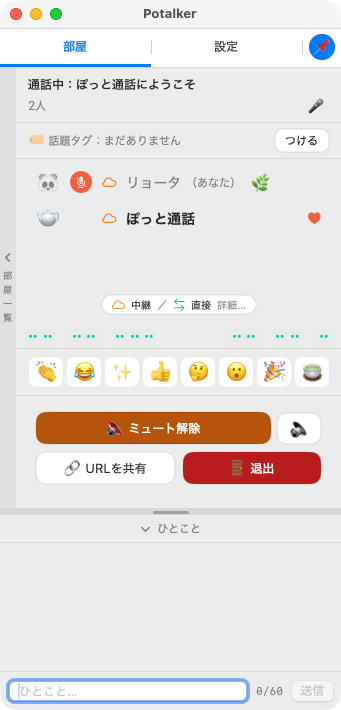
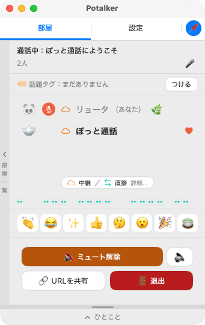

# Potalker（ぽっと通話 非公式クライアント）

> **これは非公式のクライアントです。** [ぽっと通話（potalk.app）](https://potalk.app/) の作者とは関係がありません。通話の仕組み（Nostr での相手探しと WebRTC）は、サイトのページをそのまま利用し、画面まわりだけを、Mac（macOS）・Windows・Linux 向けに、それぞれ作り直しています。ご利用は自己責任でお願いします。

## どれをダウンロードする？

ダウンロードは、すべて [Releases](https://github.com/riryo3/potalk/releases) からです。**Releases の「Latest」の印は、Windows 版についていることがあります。Mac の方も、下の表で、ご自分のファイルを選んでください。**

### まず、これだけ（迷ったら）

| あなたの環境 | おすすめ | ファイル |
|---|---|---|
| **Mac**（macOS 14 以降） | **Mac 版（安定版）** | `Potalker-0.3.2.zip` |
| **Windows**（10 / 11、64bit） | **Windows 版** | `Potalker-win-x64.zip` |
| **Linux** | **Electron 版（Linux）** | `PotalkerElectron-<版>-linux-x86_64.AppImage`（ARM 機は `…-linux-arm64.AppImage`） |

### 全部の一覧

| 種類 | 対象 | ファイル（Releases のタグ） | 状態 | 確認できていること |
|---|---|---|---|---|
| **Mac 版**（Swift 製・安定版） | Mac（Apple シリコン・Intel 両対応）、macOS 14 以降 | `Potalker-0.3.2.zip`（`v0.3.2`） | 安定版 | 実機で、通話まで、使っています |
| **Mac 版**（試用版） | 同上 | `Potalker-0.3.3-beta.zip`（`v0.3.3-beta`） | **試用版** | エラーの帯・「つなぎ直す」ボタンを追加。**実際の通話でのエラー時の動きは、未確認** |
| **Windows 版**（C# / WPF 製） | Windows 10 / 11、64bit | `Potalker-win-x64.zip`（`win-v0.3.x`） | 安定版 | **Windows 11 の実機**で、確認しています（本人確認（X・GitHub・Nostr）は、まだ、実機で試していません） |
| **Linux 版**（Python / Qt 製） | Linux（Ubuntu 24.04 相当、x86_64） | `Potalker-x86_64.AppImage`（約 227MB）／`Potalker-linux-x64.zip`（`linux-v0.1.x`） | **アルファ版** | **未確認**（開発した担当が、仮想環境で動かしただけで、リポジトリの管理者は、まだ、確認できていません） |
| **Electron 版（Linux）** | Linux（PC：x86_64、ARM 機：arm64） | `PotalkerElectron-<版>-linux-x86_64.AppImage`／`…-linux-arm64.AppImage`（約 108MB）（`electron-v…-beta`） | **試用版** | **ARM64**：Ubuntu 24.04 の**仮想マシン**（Mac 上）で、Mac 版との通話（声の往復）まで確認。ARM の実機は未確認。**x86_64：未確認** |
| **Electron 版（Mac）** | Mac（Apple シリコン） | `PotalkerElectron-<版>-mac-arm64.zip`（同上） | **試用版** | 起動・画面を確認 |
| **Electron 版（Windows）** | Windows（x64） | `PotalkerElectron-<版>-win-x64.zip`（同上） | **試用版** | **Windows 11 の実機**で、動かしています |

### 選び方

- **Mac の方**: 普通に使うなら、**Mac 版（安定版）**です。新しい機能（エラーの帯・つなぎ直すボタン）を、試したい方は、試用版を。Electron 版（Mac）は、Linux 版と、見た目や動きを、そろえるための、試用版です。
- **Windows の方**: **Windows 版**です。Electron 版（Windows）は、試用版ですが、Windows 11 の実機で、動かしています。Linux・Mac の Electron 版と、見た目や動きを、そろえたい方は、こちらも選べます。
- **Linux の方**: **Electron 版（Linux）をおすすめします。** Qt 製の Linux 版は、まだ、確認できていません。どちらも、試験段階で、実機での報告を、集めています。

  | | Linux 版（Qt 製） | Electron 版（Linux） |
  |---|---|---|
  | 作り | Python と Qt の、ネイティブ版 | Electron（Chromium）。Mac 版に、見た目を合わせています |
  | 大きさ | 約 227MB | 約 108MB |
  | 確認 | **未確認** | **ARM64** は仮想マシン（Mac 上の Ubuntu 24.04）で、Mac 版との通話・名刺・効果音まで確認。実機は未確認。**x86_64 は未確認** |
  | 対応 | x86_64 | x86_64、ARM（arm64） |
  | 起動前に | 実行権限をつける | 実行権限をつける + `sudo apt install libfuse2t64`（Ubuntu 22.04 は `libfuse2`） |
  | おすすめ | － | **こちら** |

### 名前の見分け方

- `Potalker-…`：ネイティブ版（Mac 版・Windows 版・Linux 版）
- `PotalkerElectron-…`：Electron 版（窓の名前は `Potalker-Electron`）。くわしくは `potalk-electron-R-ver/README.md`

### フォルダ（ソース）

| フォルダ | 中身 |
|---|---|
| `potalk-swift/` | Swift 製（AppKit / SwiftUI）の **Potalker**（Mac 版）。画面に出ない WKWebView で、通話の仕組みを動かす。 |
| `potalk-win/` | C# 製（WPF / WebView2）の **Potalker**（Windows 版）。画面に出ない WebView2 で、通話の仕組みを動かす。 |
| `potalk-linux/` | Python 製（Qt）の **Potalker**（Linux 版・アルファ）。 |
| `potalk-electron-R-ver/` | Electron 製の **PotalkerElectron**（Linux・Mac・Windows 向けの試用版）。 |
| `potalk-mac/` | Electron 製（先に作った試作版）。現在は、田上光さん（[@wanderingdj](https://x.com/wanderingdj)）が、保守してくださっています。現役の Electron 版は、`potalk-electron-R-ver/` です。 |

- どれも、通話の仕組みは、画面に出ないブラウザ部品で、potalk.app を、そのまま動かし、画面だけを、それぞれの環境向けに、作り直しています。
- 動いた・動かなかったの報告や、プルリクエスト、Issue を、お待ちしています。

## 開き方の詳細（Mac 版・Windows 版）

### Mac 版

[Releases](https://github.com/riryo3/potalk/releases) から `Potalker-*.zip` をダウンロードして、展開した「Potalker.app」を「アプリケーション」に入れてください（Apple Silicon・Intel 両対応、macOS 14 以降）。

- Apple の公証を受けていない（署名なし）ため、**最初の 1 回だけ**、次の手順が必要です。2 回目からは、普通にダブルクリックで開きます。

  1. アプリをダブルクリックします。「開けません」と出たら、**「完了」**（または「キャンセル」）で閉じます。
  2. 「システム設定」→「**プライバシーとセキュリティ**」を開いて、下へスクロールします。
  3. 「"Potalker" はブロックされました」の横の、**「このまま開く」**を押します。
  4. パスワードか Touch ID を求められたら入力します。もう一度出る確認で、「開く」を押します。

  macOS 15（Sequoia）以降は、この手順です（実機で確認しています）。以前の macOS では、アプリを**右クリック →「開く」**でも開けることがあります（こちらは未確認です）。

  ターミナルが使える方は、次の 1 行でも開けます（置いた場所に合わせて書き換えてください）。

  ```bash
  xattr -dr com.apple.quarantine /Applications/Potalker.app
  ```

- Electron 版（Mac）の `PotalkerElectron.app` も、同じ手順です（表示は「"PotalkerElectron" はブロックされました」になります）。コマンドは `/Applications/PotalkerElectron.app` に書き換えてください。

- 初回の起動で、マイク・ローカルネットワーク・通知の許可を求められます。

### Windows 版

[Releases](https://github.com/riryo3/potalk/releases) から `Potalker-win-x64.zip` をダウンロードして展開し、`Potalker.exe` を実行してください（.NET の別途インストールは不要です）。

- 署名していないため、SmartScreen の警告が出ることがあります（「詳細情報」→「実行」）。
- 通話の描画に Microsoft Edge WebView2 ランタイムを使います（Windows 11 には最初から入っています。入っていない場合は起動時にエラーが出ます）。
- 初回の通話で、マイクの許可を求められることがあります。
- 設定とウィンドウの位置は `%APPDATA%\Potalker\` に保存されます。

## 使い方（Mac 版・Windows 版 共通）

### ウインドウの使い方（複数ウインドウ／シングルペイン）

初期設定の窓（左上の名前のボタン）の「シングルペイン（1つの窓にまとめる）」で、切り替えます。通話中に切り替えても、通話は続きます。ショートカットでも切り替えられます（下の表）。

- **複数ウインドウ（既定）**: ロビー、部屋、ひとこと、おたより、設定を、別々の小窓で開きます。小窓は、画面の端や、ほかの窓に吸い付きます。
- **シングルペイン**: 小さな画面向けです。1つの窓にまとめます。
  - 入室前は、縦長の部屋一覧です。入室すると、部屋の小窓くらいの幅になります（窓の右端と上端は動きません）。
  - 上のタブで、部屋、おたより（配信部屋のときだけ）、設定を切り替えます。新着があるタブは、色がつきます（雑談部屋に新しい人が入ったときは、「部屋」のタブ）。
  - 窓の端の取っ手から、部屋の一覧が、ドロワーとして開きます。窓の左に出す余地があれば左、なければ右に出ます。開いたまま窓を動かして、画面の外に出そうになったら、反対側に出し直します（Mac 版）。
  - 「📌」で、ほかの窓の上に浮かせる（最前面）かどうかを切り替えます。既定はオンです。
  - **ひとこと（Mac 版・Windows 版）**: 上のタブではなく、窓の下の「ひとこと」から開くドロワーです。開くと、その高さのぶんだけ窓が下に伸び、上の部屋の画面は変わりません。開いているときは、仕切りの帯をドラッグすると、窓の高さが変わり（ひとこと側の高さはそのまま）、窓の下の縁を引っぱると、ひとこと側が広がります。新着があると、見出しに色がつきます。
  - **表示サイズ（Mac 版・Windows 版）**: 小さな画面向けに、50〜100% の6段階（100・90・80・70・60・50）で選べます。Mac はウインドウメニューか初期設定、Windows は本体の窓の上のメニュー（ウインドウ）か初期設定から選びます。シングルペインだけでなく、複数ウインドウでも、すべての窓の大きさと中身にかかります。
  - 窓の最小の高さは、上のタブからひとことまでが切れない高さ（メンバー4人分くらい）です。

#### 画面（Mac 版・シングルペイン）

| 部屋一覧のドロワーが、窓の左に出たところ | 部屋一覧のドロワーが、窓の右に出たところ |
|---|---|
|  |  |

| ひとことを開いたところ | ひとことを閉じたところ |
|---|---|
|  |  |

### ショートカット

| 動き | Mac | Windows |
|---|---|---|
| メインウインドウ（本体）を前に出す | ⌘1 | Ctrl+1 |
| 部屋 | ⌘2 | Ctrl+2 |
| ひとこと | ⌘3 | Ctrl+3 |
| おたより（配信部屋のとき） | ⌘4 | Ctrl+4 |
| 部屋の設定 | ⌘5 | Ctrl+5 |
| 部屋一覧のドロワーを開く／閉じる（シングルペイン） | ⌘L | Ctrl+L |
| 次のタブ／前のタブ（シングルペイン） | ⌘] ／ ⌘[ | Ctrl+] ／ Ctrl+[ |
| シングルペインで表示（オン・オフ） | ⇧⌘P | Ctrl+Shift+P |
| マイクのミュート | ⇧⌘M | Ctrl+Shift+M |
| スピーカーのミュート | ⇧⌘S | Ctrl+Shift+S |

- 複数ウインドウのときは、「部屋」「ひとこと」などの項目は、その窓を前に出します。シングルペインのときは、タブを切り替えます。
- 入室していないあいだは、部屋まわりの項目は使えません。Mac では、ウインドウメニューに並んでいます。Windows では「これはなに？」の窓にも載っています。

### 検索

ロビーの検索欄は、部屋名・話題タグ・いま部屋にいる人の名前を探します。全角と半角、大文字と小文字、ひらがなとカタカナの違いを、区別しません。部屋の URL（`#room=…`）を貼ると、その部屋に絞り込みます。

### 通知（Mac 版）

新しい部屋ができると、通知と音でお知らせします（ロビー下の「部屋の通知」で、オン・オフ）。作られて数分以内の部屋だけを通知します。起動、読み込み直し、入室、退出、部屋の作成、「更新」のあとの数秒は、通知を止めます。

### 自衛ワード（Mac 版・Windows 版）

見たくない部屋に近づかないための、Potalker 独自の機能です。相手を止める「ブロック」ではありません（相手には何も伝わらず、自分の部屋への入室も止められません）。

- 初期設定の「🛡 自衛ワードを登録…」、またはウインドウメニューの「自衛ワードの登録…」（Windows 版は、本体の窓の上の「ウインドウ」メニュー）から、登録の窓を開きます。入力欄にワードを入れて「登録」を押すと、下の枠に並びます（新しいワードが先頭）。枠のワードを押すと、消すかどうかを聞かれます。
- 登録したワードを、部屋の名前・話題タグ・タグを付けた人・いまいる人のユーザー名に含む部屋は、部屋の一覧に出しません。新しい部屋の通知も出しません。全角半角・大文字小文字・ひらがなカタカナは、区別しません。部屋の URL を貼ったときは、その部屋を出します。
- 入った部屋に、自衛ワードを含む名前の人がいたら、1人につき1回、通知します。
- 「書き出し…」「読み込み…」で、ファイルに保存・復元できます。ファイル名は日付つき（`jiei-words-2026-10-28.txt` のような形）。形式は、UTF-8（BOM なし）・LF・1行に1ワード・先頭が最新です。読み込みは、LF・CRLF・CR と BOM を受け付け、すでにあるワードは飛ばします。

### 部屋の URL の共有

部屋の URL のコピーでは、`&name=…` を省きます（ひとこと欄の 60 文字に収まるように）。Windows 版では、初期設定でオフにできます。

### 終了するとき

入室中（部屋を開いている場合も含む）にアプリを終了しようとすると、確認が出ます。「退出して終了」を選ぶと、部屋から退出して終了します。

### 初回の起動

初回だけ、ぽっと通話の作者への感謝を、ごあいさつの画面に出します。「次から表示しない」の☑を外して閉じると、次の起動でも、もう一度出ます。「これはなに？」からも読めます。

## OS ごとの注意

### Mac 版で、キーチェーンの確認（パスワードの入力）が出ることがあります

Mac 版（Swift 版）では、「Potalker がキーチェーン内の “Potalker WebCrypto Master Key” に保存されている機密情報を使用しようとしています」という確認が出て、Mac のログインパスワードを求められることがあります。**Windows 版・Electron 版では出ません。**

- **出る場面**: 名刺の本人確認（X・GitHub・Nostr の ✅）をしている人が、相手に名刺を見られたとき。名刺の設定を開いたとき、本人確認を始めたとき。
- **理由**: 名刺の鍵（取り出せない形で、この Mac の中に保存されています）を読むとき、macOS が、キーチェーンの許可を確認するためです。Web の部品（WebKit）の仕様で、アプリ側では避けられません。通常の通話だけなら、起動時には出ません。
- **対処**: 「常に許可」を押すと、同じアプリのあいだは、出なくなります。「拒否」を押しても、アプリは使えます（本人確認の ✅ を相手に見せる機能だけが、使えなくなります）。
- **ビルドし直すと、また出ます**: 簡易署名のアプリは、ビルドのたびに、署名の素性が変わります。署名用の証明書を使うと（下の「Mac 版のビルド」を参照）、出なくなります。

### Windows 版

- 本人確認（X・GitHub・Nostr）は、まだ実機で試していません。

## ビルド

### Mac 版のビルド

```bash
cd potalk-swift
./make_app.sh release     # build/Potalker.app ができる（簡易署名・この Mac の CPU 用）
./make_app.sh universal   # Apple Silicon と Intel の両対応
```

- macOS 14 以降、Xcode（Swift 6）が必要です。
- 署名用の証明書がある場合は、`CODESIGN_ID="証明書の名前" ./make_app.sh release` のように指定できます。署名が変わらなければ、キーチェーンの「常に許可」が、ビルドし直しても効き続けます（既定は簡易署名で、ビルドのたびに許可の確認が出ることがあります）。
- ページへの小さな差し込み（過去ログ共有、リアクションの効果など）は `Sources/PotalkMac/PagePatcher.swift` にあります。差し込み位置が見つからないときは、元のページをそのまま使います。

### Windows 版のビルド

```bash
cd potalk-win
dotnet publish -c Release -r win-x64 --self-contained true -p:PublishSingleFile=true -p:IncludeNativeLibrariesForSelfExtract=true -o out
```

- .NET 8 SDK が必要です。GitHub Actions（`.github/workflows/build-windows-native.yml`）でも作れます。`win-v*` のタグを付けて push すると、Releases に zip が載ります。
- ページへの小さな差し込みは `PagePatcher.cs` にあります（Mac 版と同じ内容）。

## Electron 版（Windows・試作）

Electron 版（`potalk-mac/`）も、Windows 向けにビルドできます。GitHub Actions（`.github/workflows/build-windows.yml`）が、インストーラー（.exe）と zip を作ります。新しい Windows 版（`potalk-win/`）のほうが小さく軽いので、こちらは試作として残しています。

- ローカルで作る場合: `cd potalk-mac && npm ci && npm run dist:win`

## Linux 版（試験中）

Electron 版（`potalk-mac/`）は、Linux でも起動できます。2026年10月に、Linux Mint（ThinkPad L570）での動作報告がありました。起動直後は少し重いものの、動き出してからは快適に使えたとのことです。

- 必要なものは Node.js（動作報告の環境は v24 LTS）と git です。起動方法は下の「Electron 版」と同じです。

  ```bash
  git clone https://github.com/riryo3/potalk.git
  cd potalk/potalk-mac
  npm install
  npm start
  ```

- ライブラリ不足で起動しない場合は、次を入れてください（Linux Mint 22 / Ubuntu 24.04 系。21 系では `libasound2t64` の代わりに `libasound2` を使います）。

  ```bash
  sudo apt install -y libgtk-3-0 libnss3 libasound2t64
  ```

- `The SUID sandbox helper binary was found, but is not configured correctly` というエラーで止まる場合は、サンドボックスなしで起動できます。

  ```bash
  npx electron --no-sandbox .
  ```

  `--no-sandbox` は、Chromium の安全のための仕組み（サンドボックス）を切る回避策です。使うのは、ご自分の手元で、信頼できるサイトだけを開く場合に限ってください。毎回ではなく恒常的に対処したい場合は、`node_modules/electron/dist/chrome-sandbox` の所有者を root にし、権限を 4755 に直してください（`sudo` が必要です）。

- この節は、試作の Electron 版（`potalk-mac/`）を、ソースから動かす方法です。ビルド済みの AppImage は、[Releases](https://github.com/riryo3/potalk/releases) にあります（上の「どれをダウンロードする？」を参照）。

## Electron 版

```bash
cd potalk-mac
npm install
npm start
```

### ウィンドウモード（バラバラ／統合）

Electron 版には、画面の出し方が2つあります。切り替えはアプリを再起動して適用され、設定は `userData/ui-mode.json` に保存されます。

- **バラバラ**（既定）：従来どおり、ロビー・部屋・ひとこと等を別々のウィンドウで開く出し方です。
- **統合**：1つのウィンドウに集約する出し方です。左端のレール（アイコンだけの細い帯、名称はツールチップで表示）で、ロビー／部屋／ひとこと（未読バッジつき）／おたより／部屋設定／部屋を作る、などを切り替えます。
  - レールの色はページのテーマに追随します（ダーク固定への切り替えも可）。レールを左端に隠して、カーソルを寄せたときだけ出すドロワー表示もできます。
  - ロビー表示のまま左端にカーソルを寄せると、部屋一覧がのぞきます（ホバー式ピーク）。
  - 部屋一覧を詰めて表示するコンパクト表示があります。
  - ウィンドウの高さは未入室と入室中で別々に覚え、入室すると縦に伸び、退出すると戻ります。
  - 部屋パネルの操作ボタン（ひとこと／ミュート／URL共有／退出など）はアイコンだけにして、リアクションと1行に並べています。ひとことの新着はバッジで知らせます。
  - アクセス測定についての注記は、ロビーではなく設定（プロフィール欄）の中に表示します。

統合モードの動作確認は、主に Linux（Linux Mint）上の Electron 版で進めています。

## 参考にしたもの

このクライアントは、ぽっと通話の公開リポジトリ **[po-talk/po-talk.github.io](https://github.com/po-talk/po-talk.github.io)** を参考にして作りました。ページの構造や、通話の仕組み（部屋の探索、データのやり取り）を、このリポジトリのソースで調べ、画面まわりを Mac と Windows 向けに作り直しています。実行時には、公開されている potalk.app のページをそのまま読み込んで使います。サイトの作者の方々に感謝します。

## 注意

- 実験用の非公式クライアントです。通話の相手探しや中継（TURN）は、potalk.app と同じ仕組みを使っています。
- サイト本体（potalk.app）の作者は別の方です。このリポジトリには、サイトのソースは含めていません。
- 「ぽっと通話」「potalk」の名前とサイトは、それぞれの作者のものです。

## ライセンス

このリポジトリのコードは [MIT License](LICENSE) です（Copyright (c) 2026 riryo3）。参考にしたリポジトリのライセンスの表示は、[THIRD_PARTY_NOTICES.md](THIRD_PARTY_NOTICES.md) にあります。
